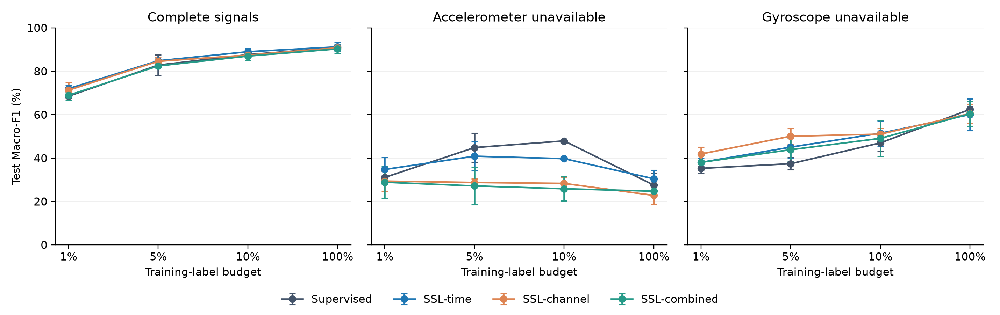

# Sensor SSL · Human Activity Recognition

**Self-supervised learning with limited labels and missing sensor signals**

Empirical study · UCI HAR · 48 training runs · 144 test evaluations

โปรเจกต์วิจัย Self-Supervised Learning สำหรับจำแนกกิจกรรมจากเซนเซอร์เมื่อข้อมูลติดป้ายกำกับมีน้อย พร้อมการทดลองสัญญาณขาดหาย งานนี้เป็นการศึกษาเชิงทดลองที่ตรวจซ้ำได้ ไม่อ้างว่าเป็นวิธีใหม่หรือพร้อมตีพิมพ์

| เริ่มอ่าน | ทดลองซ้ำ | ตรวจผล |
|---|---|---|
| [คู่มือภาษาไทย](START_HERE_TH.md) · [รายงาน PDF](results/research-report.pdf) | [วิธีรันซ้ำ](docs/REPRODUCE.md) · [protocol](docs/PROTOCOL_TH.md) | [ผลภาษาไทย](results/RESULTS_TH.md) · [ผลทั้งหมด 144 รายการ](results/all_evaluations.csv) |

## ผลหลัก

คะแนน **Macro-F1 บน test set ที่สัญญาณครบ** (%, ค่าเฉลี่ย ± sample SD จาก 3 seeds):

| Training labels | Supervised | SSL-time | ผลต่างแบบจับคู่ |
|---:|---:|---:|---:|
| 1% (61 ตัวอย่าง) | 68.52 ± 0.84 | **72.00 ± 1.47** | **+3.48 จุดเปอร์เซ็นต์** |
| 5% (295 ตัวอย่าง) | 82.85 ± 4.79 | **84.86 ± 0.72** | +2.01 จุดเปอร์เซ็นต์ |
| 10% (586 ตัวอย่าง) | 87.68 ± 2.68 | **89.01 ± 1.47** | +1.33 จุดเปอร์เซ็นต์ |
| 100% (5,844 ตัวอย่าง) | 90.92 ± 0.46 | **91.26 ± 2.02** | +0.35 จุดเปอร์เซ็นต์ |



ผลเมื่อ accelerometer หรือ gyroscope หายทั้งกลุ่มแตกต่างกันตามชนิดเซนเซอร์และวิธีฝึก จึงไม่สรุปว่า SSL วิธีใดทนต่อเซนเซอร์หายได้ทุกกรณี ขอบเขตผลนี้มีเพียงข้อมูลหนึ่งชุด การแบ่งผู้ใช้หนึ่งแบบ และ 3 random seeds ดู [ตารางครบทุกวิธี](results/RESULTS_TH.md) และ [ข้อจำกัดในรายงาน](results/research-report.pdf)

## โครงสร้างโปรเจกต์

| ตำแหน่ง | เนื้อหา |
|---|---|
| `src/` | โหลดข้อมูล ฝึกโมเดล ประเมินผล และทำนาย |
| `run_matrix.py` | รันการทดลอง 48 configurations |
| `scripts/` | ตรวจผล สรุปสถิติ และสร้างรายงาน |
| `tests/` | ตรวจ split, scaling, masking และ metrics |
| `results/` | ตารางผล กราฟ รายงาน และหลักฐาน JSON ของแต่ละ run |
| `docs/` | protocol, งานที่เกี่ยวข้อง, draft paper และคู่มือ |
| `START_COLAB.ipynb` | ทางเลือกสำหรับ Colab; ยังไม่ได้ทดสอบบนบริการ Colab จริง |

## เริ่มใช้งาน

ใช้ Python 3.11 ขึ้นไป แนะนำ virtual environment และ CPU สำหรับเริ่มต้น:

```bash
python -m venv .venv
source .venv/bin/activate
# Windows: .venv\Scripts\activate
python -m pip install -r requirements.txt
python -m unittest discover -v
python -m src.experiment --smoke --mode ssl --mask time --epochs 1 --pretrain-epochs 1 --output runs/smoke
```

ทดลองข้อมูลจริงหนึ่งงาน (สั่งดาวน์โหลด UCI HAR ประมาณ 60 MB และตรวจ checksum ก่อน):

```bash
python -m src.download_data
python -m src.experiment --mode supervised --fraction 0.1 --output runs/baseline
python -m src.experiment --mode ssl --mask time --fraction 0.1 --output runs/ssl-time
```

รันครบ 48 configurations: 4 วิธี × 4 สัดส่วน × 3 seeds ประเมิน 3 สภาพสัญญาณต่อ configuration รวม 144 evaluations:

```bash
python run_matrix.py --epochs 30 --pretrain-epochs 30
python -m src.summarize runs/full --output results/summary.csv
```

รองรับ `--device cuda` หรือ `--device mps` เมื่อเครื่องรองรับ ผลอาจต่างระหว่างอุปกรณ์ ต้องรายงาน environment ทุกครั้ง อย่าเปลี่ยนจำนวน epochs หรืออุปกรณ์แล้ว resume ในโฟลเดอร์เดิม: ใช้ `--runs runs/new_protocol` แทน

## ข้อมูลและวิธี

ใช้ UCI HAR inertial signals 6 ช่อง: total acceleration XYZ และ gyroscope XYZ ไม่ใช้ 561 handcrafted features และไม่ใช้ derived body acceleration เพื่อหลีกเลี่ยงช่องซ้ำเมื่อจำลอง sensor outage แต่ละหน้าต่างมี 128 samples (2.56 วินาทีที่ 50 Hz) ซึ่งชุดข้อมูลจัดเตรียมไว้แล้ว

ใช้ official test subjects; กัน validation subjects 4 คนจาก official train ด้วย split seed 2026 ผู้ใช้ไม่ซ้ำกันระหว่างชุด Standardization คำนวณจาก train เท่านั้น ป้ายกำกับ validation ใช้ครบทุกตัวอย่างเพื่อเลือก checkpoint ดังนั้นเปอร์เซ็นต์ป้ายหมายถึง **training labels เท่านั้น** ไม่ใช่งบ annotation รวม การสุ่มแบบ stratified ต้องใช้ป้ายเดิมเพื่อจำลอง label scarcity; ไม่ได้จำลองกระบวนการเลือกข้อมูลไร้ป้ายจริง

Encoder: Conv1d 6→32→64 + GroupNorm + GELU; mean pooling + linear head; SSL decoder เป็น Conv1d 64→6 ฝึก MSE เฉพาะตำแหน่งที่ปิดบัง

- supervised: เริ่มจาก random encoder
- time: ปิดช่วงเวลาต่อเนื่อง 25% ของหน้าต่าง
- channel: ปิดหนึ่งช่องจากหกช่อง
- both: รวมสองแบบ (อัตราปิดบังรวมสูงกว่า จึงยังแยกผลชนิด mask กับปริมาณ mask ไม่ได้)

SSL ใช้ train signals ทุกตัวอย่างโดยไม่อ่านป้ายเป็น target; fine-tune ทุก layer; Adam lr=0.001, batch=128, fixed epochs; เลือก checkpoint ด้วย validation Macro-F1 บนข้อมูลปกติเท่านั้น เมล็ดสุ่ม 0,1,2 ใช้ labeled subset เดียวกันข้ามวิธีและ nested subsets ข้ามสัดส่วน บันทึกจำนวนจริงเพราะปัดขึ้นต่อคลาส

Test conditions: none, acc (ปิดทั้ง 3 แกนความเร่ง), gyro (ปิดทั้ง 3 แกนไจโร) ค่าแทนที่เป็น 0 หลัง normalization = ค่าเฉลี่ย train ไม่ใช่ศูนย์เชิงกายภาพ เป็น stress test แบบจำลอง ไม่ใช่การทดสอบ hardware failure จริง และ dropout ทั้งกลุ่มแรงกว่าการปิดหนึ่งช่องขณะ pretraining

## ผลลัพธ์และการทำซ้ำ

ทุก run มี metadata.json, history.json, results.json, best.pt; run ที่ pretrain ใหม่มี encoder.pt การ reuse encoder ตรวจ configuration และ data hash ผล smoke เป็นข้อมูลสังเคราะห์และถูกกันออกจาก summary โดยอัตโนมัติ ห้ามรายงานเป็นผลวิจัย

อ่าน `docs/PROTOCOL_TH.md`, `docs/PAPER_DRAFT.md`, และรายงานผลเมื่อมีใน `results/` โมเดลที่ส่งแยกจาก source ZIP สามารถใช้ร่วมกับ normalization ใน metadata ได้

## เผยแพร่บน GitHub

ดู [คู่มือคำสั่ง Git ภาษาไทย](docs/GITHUB_PUBLISH_TH.md) สำหรับการแตก source ZIP, กู้ประวัติ Git จาก `repository.bundle`, สร้าง repository แบบ Public และ push ขึ้น GitHub อย่างเป็นขั้นตอน ชุดไฟล์สำหรับ GitHub รวมโค้ด ผลสรุป กราฟ และหลักฐาน JSON แต่ `.gitignore` กันข้อมูลดิบ น้ำหนักโมเดล และ secrets ไว้

ผู้เขียนควรเลือก license ของโค้ดและตกลงกับอาจารย์ก่อนอนุญาตให้ผู้อื่นนำไปใช้ การเปิด repository แบบ public ไม่เท่ากับการกำหนด open-source license

## Attribution

Dataset: Reyes-Ortiz et al. (2013), Human Activity Recognition Using Smartphones, UCI, DOI https://doi.org/10.24432/C54S4K ; CC BY 4.0 ตามหน้า UCI https://archive.ics.uci.edu/dataset/240/human+activity+recognition+using+smartphones . ชุดทดลองนี้ใช้ teaching mirror ที่บันทึก provenance ไว้ ไม่รวมข้อมูลดิบใน source archive

Related work (ยังไม่ได้ reproduce): TS-TCC https://arxiv.org/abs/2106.14112 ; TS2Vec https://arxiv.org/abs/2106.10466 . โค้ดนี้เป็น masked reconstruction baseline เขียนใหม่ ไม่ใช่ implementation ของสองบทความดังกล่าว

ข้อมูลที่ใช้รันในชุดส่งมอบดาวน์โหลดจาก teaching mirror ของ UCI HAR เพราะ origin ช้า ดู URL, SHA-256 และขอบเขตการตรวจใน `docs/DATA_PROVENANCE.json` หากต้องการทำซ้ำด้วย archive เดียวกันให้ดาวน์โหลด URL ดังกล่าวเป็น `data/uci_har.zip` แล้วคัดลอก provenance ไป `data/provenance.json`

## ชุดส่งมอบ

ดู `START_HERE_TH.md` เพื่ออ่านไฟล์ตามลำดับ ผลวิจัยจริงทั้งหมดอยู่ใน `results/` และวิธีสร้างรายงานซ้ำอยู่ใน `docs/REPRODUCE.md`
# Self-Supervised-Learning
